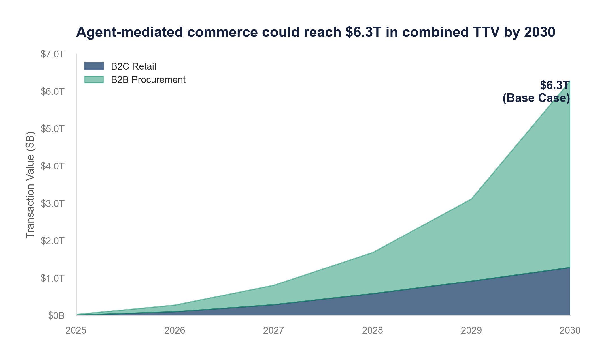
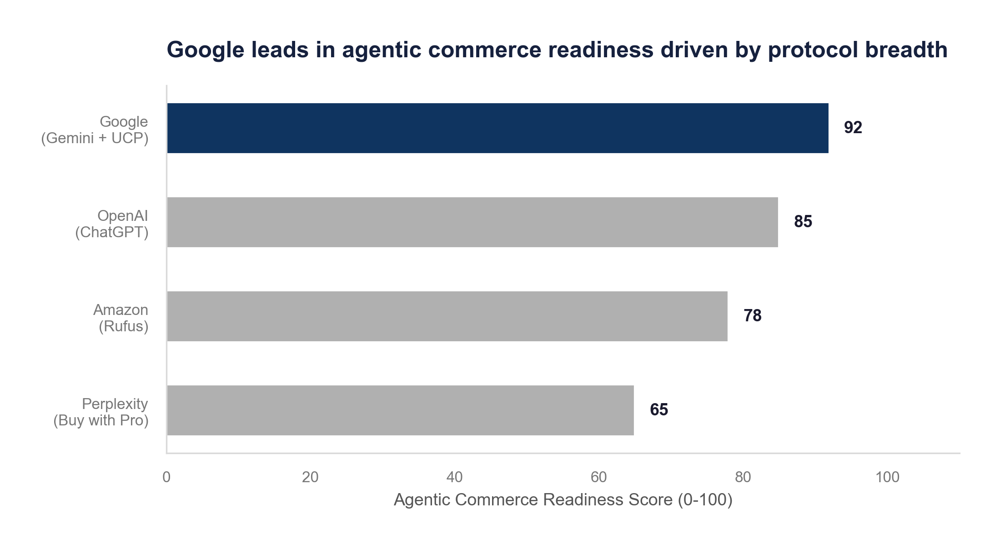
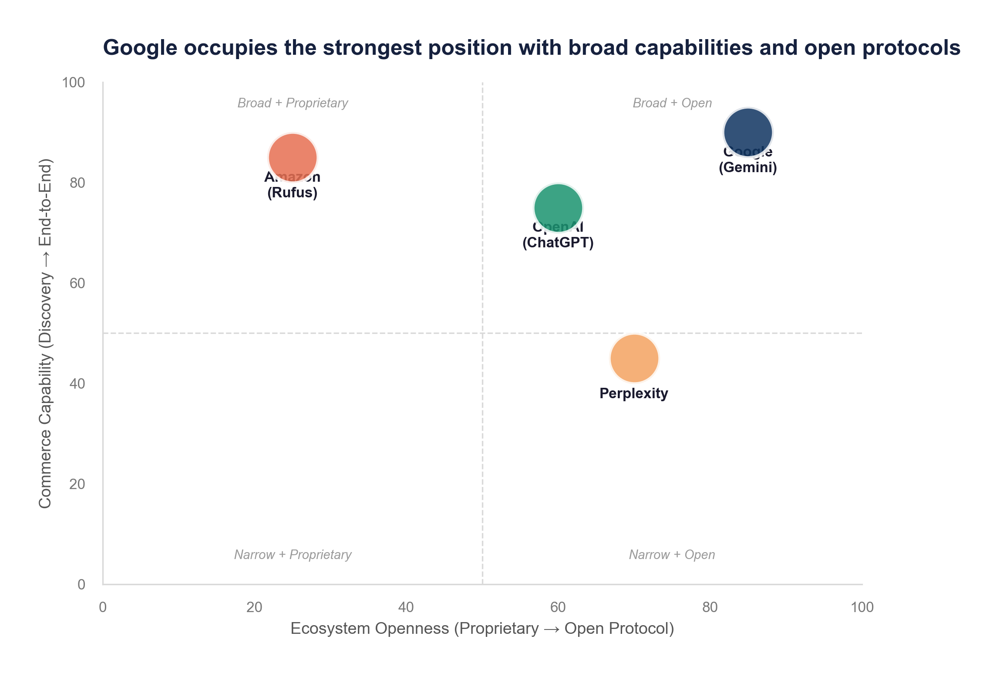
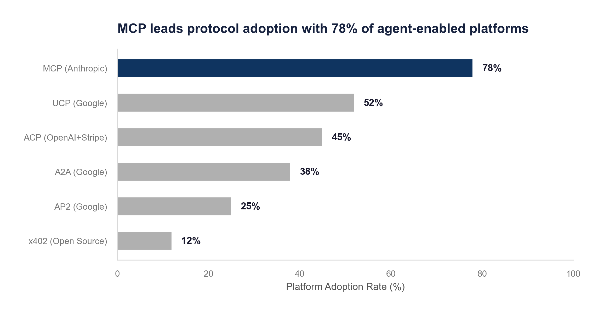
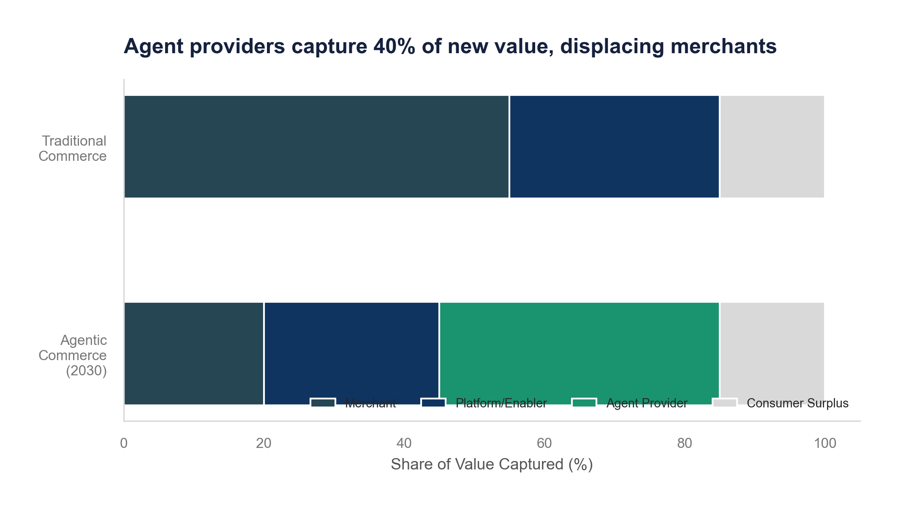
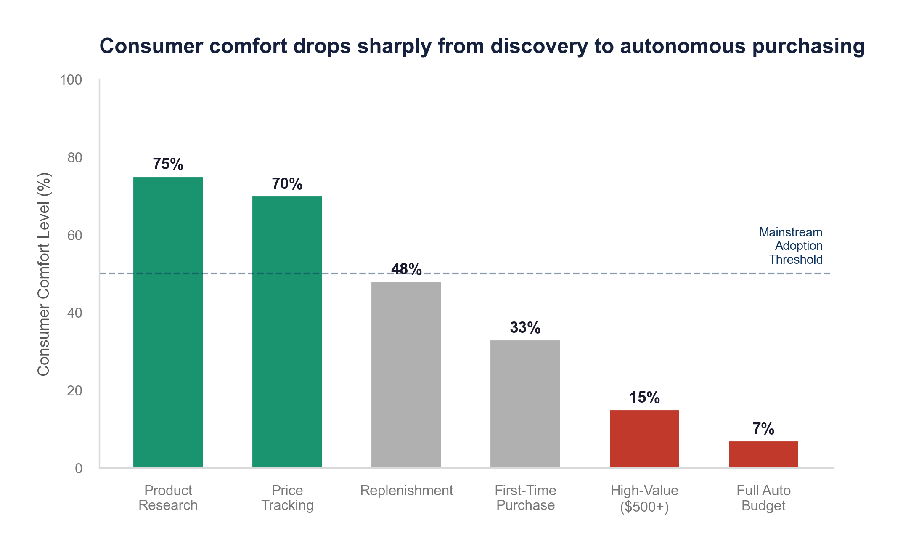
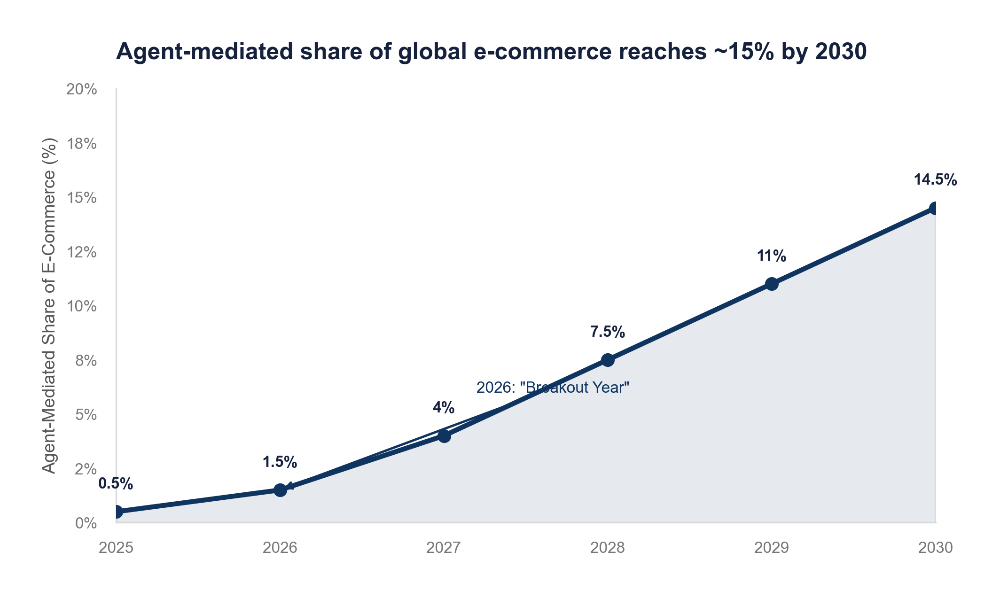
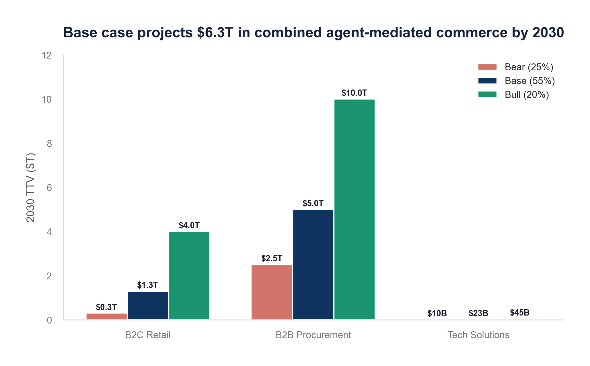

# Agentic Commerce: Market Sizing, Competitive Dynamics, and Strategic Implications

**Agentic Commerce: The Next Frontier of Digital Trade**

Market Analysis, Competitive Landscape, and Five-Year Strategic Outlook

**Prepared by:** Vedang Vatsa
**Date:** April 2026

*This document has been prepared for the exclusive use of internal strategy teams. It contains proprietary and confidential information. No part of this report may be reproduced, distributed, or communicated to any third party without express prior written consent. The findings are based on information available at the time of preparation. The author accepts no liability for decisions made in reliance on this report.*

---

## Executive Summary

**Autonomous AI agents are poised to intermediate $1.5-5 trillion in global commerce by 2030, creating the largest structural shift in digital trade since the invention of the shopping cart.**

  

    $6.4T
    Global E-Commerce 2025
    +8.2% YoY
  

  

    $1.5T
    Agent-Mediated TTV by 2030
    Juniper Research estimate
  

  

    35.7%
    Technology Solutions CAGR
    2026-2033 (Grand View)
  

  

    90%
    B2B Buying via Agents by 2028
    Gartner forecast
  

**Situation.** Global e-commerce reached $6.4 trillion in 2025, growing steadily at 8-10% annually. The underlying transaction model, where a human browses, selects, and checks out, has remained unchanged for two decades.

**Complication.** A new category of AI, agentic systems capable of autonomous reasoning and execution, can now complete end-to-end purchase journeys without human intervention. OpenAI, Google, Amazon, and Perplexity all launched agent-driven shopping in 2025-2026. New commerce protocols (ACP, UCP, A2A, AP2) enable machine-to-machine transactions at scale.

**Resolution.** Companies must act within 12-24 months. Merchants need machine-readable catalogs and API-first architectures. Platforms must adopt open commerce protocols. Investors should target the infrastructure layer where durable advantages are forming.

> **Key Insight:** 2026 is widely identified as the "breakout year" for agentic shopping. Consumer trust remains the primary adoption barrier, with a majority of consumers in 2026 surveys uncomfortable delegating full purchasing authority to AI agents.

---

  01
  <h2>Market Definition and Context</h2>
  
Defining agentic commerce, setting boundaries, and establishing the analytical framework

## 1. Market Definition and Context

**Agentic commerce represents a structural break from two decades of static e-commerce, transferring discovery, evaluation, negotiation, and transaction execution to autonomous AI systems.**

  

    
🤖

    <strong>Autonomy</strong>
    
Agent acts independently after receiving a high-level directive from the user

  

  

    
🧠

    <strong>Multi-Step Reasoning</strong>
    
Decomposes tasks, queries sources, evaluates trade-offs, makes selections

  

  

    
🌐

    <strong>Cross-Platform</strong>
    
Operates across merchant boundaries, comparing prices and availability

  

  

    
💳

    <strong>Transaction Completion</strong>
    
Completes checkout, manages payment authorization, confirms delivery

  

  

    
🔗

    <strong>Protocol-Native</strong>
    
Uses standardized protocols (MCP, ACP, UCP) for machine-to-machine commerce

  

  

    
📊

    <strong>Data-Driven</strong>
    
Optimizes on objective metrics: price, delivery speed, reviews, specifications

  

### 1.1 Market Scope

- **Products/Services:** Consumer retail (B2C) and enterprise procurement (B2B) mediated by AI agents
- **Geographies:** Global, with emphasis on the United States, EU, and China
- **Time horizon:** 2026 through 2031
- **Exclusions:** Traditional chatbots, static recommendation engines, manual search-assisted shopping

### 1.2 Market Context

**Situation.** Global retail e-commerce reached $6.42 trillion in 2025, representing 20.5% of total retail (Statista, 2026). B2B e-commerce exceeded $32 trillion.

**Complication.** The maturation of LLMs with tool-use capabilities created a new class of software agent that autonomously completes multi-step commercial tasks. Every major platform launched agentic shopping in 2025-2026. A parallel wave of protocol standardization is creating infrastructure for machine-to-machine commerce.

**Resolution.** This report sizes the opportunity, maps the competitive landscape and technology stack, analyzes value chain disruption, and provides a strategic roadmap.

---

  02
  <h2>Market Sizing</h2>
  
TAM, SAM, SOM analysis with triangulated estimates from tier-1 analysts

## 2. Market Sizing

**The agentic commerce opportunity spans $1.5-5 trillion in mediated transaction value by 2030, with the technology solutions market reaching ~$65 billion by 2033.**

### 2.1 Total Addressable Market

The TAM must be understood through two lenses: total transaction value (TTV) that agents facilitate, and the market for enabling software/platforms.

**Exhibit 1. Agent-mediated commerce could reach $6.3T in combined TTV by 2030**

*Source: Author analysis triangulating McKinsey (2025), Juniper Research (2026), Gartner (2026)*

### 2.2 Analyst Consensus

**Exhibit 2. Analyst estimates vary by 3x depending on whether they measure transaction value or technology spend**

| Source | Metric | 2030 Estimate | Geography |
|---|---|---|---|
| McKinsey | Consumer TTV mediated | $3-5 trillion | Global |
| Juniper Research | Total TTV handled | $1.5 trillion | Global |
| Bain | E-commerce TTV | $300-500 billion | U.S. |
| Morgan Stanley | E-commerce spending | $190-385 billion | U.S. |
| Grand View Research | Technology solutions | ~$65B (2033) | Global |
| Information Matters | Broader agentic AI | $140 billion | Global |

*Source: McKinsey (2025), Juniper Research (2026), Bain (2025), Morgan Stanley (2026), Grand View Research (2026)*

### 2.3 Serviceable Addressable Market

**Exhibit 3. B2B indirect procurement and consumer commodity purchases represent the highest near-term SAM**

| Segment | 2025 Size ($T) | Agent-Addressable SAM ($T) | Agent Penetration by 2030 (%) |
|---|---|---|---|
| B2C Retail E-Commerce | 6.4 | 3.2 | 15-25% |
| B2B Indirect Procurement | 8.0 | 5.0 | 25-40% |
| B2B Direct Procurement | 24.0 | 8.0 | 5-15% |
| **Total** | **38.4** | **16.2** | |

*Source: Statista (2026), Gartner (2026), Author analysis*

---

  03
  <h2>Competitive Landscape</h2>
  
Platform positioning, protocol competition, and strategic differentiation

## 3. Competitive Landscape

**Four platform giants are racing to own the agentic shopping interface, while a parallel infrastructure battle over commerce protocols will determine the industry standard.**

### 3.1 Platform Readiness

**Exhibit 4. Google leads in agentic commerce readiness driven by protocol breadth**

*Source: Author analysis based on publicly announced capabilities and protocol adoption, April 2026*

**Exhibit 5. Platform capability comparison across the agentic commerce lifecycle**

| Platform | Primary Strength | Checkout Model | Visual Search | Unique Capability |
|---|---|---|---|---|
| Google (Gemini) | Protocol integration | Native via UCP | Yes | Universal Commerce Protocol, Direct Offers |
| OpenAI (ChatGPT) | Conversational discovery | Merchant-integrated | Yes | Side-by-side comparison, image upload |
| Amazon (Rufus) | Retail data depth | Native Amazon | Yes | "Join the chat" audio summaries |
| Perplexity | Research-led, unbiased | Buy with Pro | Yes | Ad-free, transparent sourcing |

*Source: Company announcements, Digital Commerce 360 (2026)*

### 3.2 Competitive Positioning

**Exhibit 6. Google occupies the strongest position with broad capabilities and open protocols**

*Source: Author analysis, April 2026*

### 3.3 Protocol Competition

**Exhibit 7. MCP leads protocol adoption with 78% of agent-enabled platforms**

*Source: Author analysis based on platform integration announcements, April 2026*

**Exhibit 8. Six protocols compete to define the agentic commerce stack**

| Protocol | Developer | Layer | Function |
|---|---|---|---|
| MCP | Anthropic | Foundation | Agent-to-tool/API connections ("USB-C for AI") |
| A2A | Google | Coordination | Inter-agent communication and task delegation |
| ACP | OpenAI + Stripe | Execution | Programmatic checkout, secure payment tokens |
| UCP | Google + Retailers | Discovery/Execution | Surface-agnostic commerce lifecycle |
| AP2 | Google + Partners | Payment/Trust | Mandate-based agent spending authorization |
| x402 | Open Source | Micropayment | HTTP-native machine-to-machine payments |

*Source: Anthropic (2025), Google (2026), OpenAI (2026), Stripe (2026)*

---

## 4. Technology Stack

**A four-layer protocol stack is forming to enable machine-to-machine commerce, with payment infrastructure as the critical bottleneck.**

  4 Layers
  Foundation → Coordination → Execution → Payment/Trust

**Exhibit 9. The agentic commerce stack operates across four layers**

| Layer | Function | Key Protocol | Traditional Equivalent |
|---|---|---|---|
| 1. Foundation | Agent connects to merchant data | MCP (Anthropic) | Website crawling, product feeds |
| 2. Coordination | Agents coordinate with other agents | A2A (Google) | No equivalent (humans do this) |
| 3. Execution | Cart building, checkout completion | ACP / UCP | Shopping cart, checkout page |
| 4. Payment/Trust | Authorization, fraud prevention | AP2, TAP (Visa) | Credit card form, 3D Secure |

*Source: Author analysis based on protocol documentation, 2026*

> **Key Insight:** The payment authorization problem is to agentic commerce what mobile-responsive design was to mobile commerce in 2010. A solvable infrastructure challenge that currently gates mainstream adoption. The companies that solve it first will capture outsized value.

---

## 5. Value Chain Analysis

**Value is migrating from merchants toward agent providers and infrastructure operators, creating a new "gatekeeper" dynamic that could commoditize brands.**

**Exhibit 10. Agent providers capture 40% of new value, displacing merchants**

*Source: McKinsey (2026), IBM (2026), Author analysis*

**Exhibit 11. Value capture by role in agentic vs. traditional commerce**

| Role | Traditional Value Driver | Agentic Value Driver | Shift |
|---|---|---|---|
| Agent Provider | N/A | User interface, context memory | Captures most new value |
| Platform/Enabler | Hosting, payments | APIs, identity protocols | Essential "plumbing" |
| Merchant | Brand, site design, SEO | Data quality, fulfillment speed | Commoditization risk |
| Consumer | Time browsing/comparing | Delegates to agent | Gains convenience |

*Source: McKinsey (2026), Author analysis*

> **Key Insight:** When an agent mediates a purchase, the merchant's brand identity becomes invisible. Agents optimize for objective metrics (price, delivery speed, review scores) rather than brand preference. Merchants with proprietary products or superior fulfillment are best positioned to resist commoditization.

---

  06
  <h2>Growth Drivers and Risks</h2>
  
Forces accelerating adoption and headwinds that could slow the trajectory

## 6. Growth Drivers

**Four forces are converging: improving LLM reasoning, protocol standardization, B2B procurement demand, and consumer convenience expectations.**

  

    <5%
    LLM Error Rate on Commerce Tasks
    Q1 2026 benchmarks
  

  

    $15T+
    B2B Spend via Agents by 2028
    Gartner forecast
  

  

    59%
    Mobile Commerce Share 2025
    Precedent for convenience-driven adoption
  

1. **LLM Reasoning.** Foundation models are crossing the reliability threshold for autonomous purchasing. Error rates on structured commerce tasks dropped below 5% in Q1 2026.
2. **Protocol Standardization.** The launch of MCP, A2A, ACP, UCP, and AP2 within 12 months is compressing the integration timeline from "possible" to "easy."
3. **B2B Procurement.** Gartner forecasts 90% of B2B buying will be AI-intermediated by 2028. B2B purchasing is inherently structured and amenable to automation.
4. **Consumer Convenience.** Mobile commerce grew from ~5% to 59% of e-commerce in 12 years. Agentic commerce offers a similar convenience leap.

---

## 7. Risks and Headwinds

**Consumer trust, regulatory fragmentation, and novel fraud vectors could slow adoption by 2-4 years relative to current projections.**

### 7.1 Consumer Trust Deficit

**Exhibit 12. Consumer comfort drops sharply from discovery to autonomous purchasing**

*Source: Author analysis based on PwC (2026), Visa (2026), consumer survey data*

### 7.2 Regulatory Fragmentation

**Exhibit 13. Regulatory approaches diverge sharply across the three largest markets**

| Dimension | EU | United States | United Kingdom |
|---|---|---|---|
| Approach | Risk-based, prescriptive | Innovation-first, sectoral | Principles-based |
| Key Regulator | European AI Office | CFPB, FTC, NIST | FCA, CMA, ICO |
| Agent Transaction Status | Likely "high-risk" | Legally ambiguous | Case-by-case |
| Transparency Mandate | Required | Voluntary | Expected |
| Timeline to Clarity | 2027-2028 | 2028+ | 2027 |

*Source: Hogan Lovells (2026), Data Innovation Institute (2026), UK Government (2026)*

### 7.3 Security Vectors

Key attack surfaces unique to agentic commerce:
- **Prompt injection.** Malicious instructions hidden in product descriptions manipulate agent behavior
- **Fake merchant storefronts.** Fraudulent sites with well-structured schema markup can deceive agents
- **Agent impersonation.** Bad actors creating agents that impersonate trusted platforms
- **Scope creep.** Agents accessing data beyond the user's intended authorization

---

  08
  <h2>Five-Year Outlook</h2>
  
Scenario analysis with probability-weighted projections through 2030

## 8. Five-Year Outlook

**The base case projects agent-mediated commerce reaching 10-15% of global e-commerce by 2030, with a wide range across scenarios.**

### 8.1 Agent Penetration Trajectory

**Exhibit 14. Agent-mediated share of global e-commerce reaches ~15% by 2030**

*Source: Author analysis triangulating Juniper, McKinsey, Morgan Stanley*

### 8.2 Scenario Comparison

**Exhibit 15. Base case projects $6.3T in combined agent-mediated commerce by 2030**

*Source: Author analysis*

**Exhibit 16. Scenario assumptions and implications**

| Metric | Bear (25%) | Base (55%) | Bull (20%) |
|---|---|---|---|
| 2030 B2C Agent TTV | $200-400B | $1.0-1.5T | $3-5T |
| 2030 B2B Agent TTV | $2-3T | $4-6T | $8-12T |
| Tech Solutions Market | $8-12B | $20-25B | $40-50B |
| Key Assumption | Regulatory crackdown | Steady protocol maturation | Viral adoption event |
| Primary Beneficiary | Incumbent platforms | Infrastructure providers | Agent providers |

*Source: Author analysis triangulating McKinsey, Bain, Morgan Stanley, Juniper, Gartner*

---

## 9. Strategic Recommendations

**Companies must act within 12-24 months to build infrastructure and organizational capabilities for agent-mediated commerce.**

  

    
Q3 2026

    

      <strong>Merchants: Begin catalog and API audit</strong>
      
Upgrade product data to JSON-LD schema. Build API-first checkout endpoints compatible with ACP/UCP.

    

  

  

    
Q4 2026

    

      <strong>Platforms: Ship protocol support</strong>
      
Native support for ACP + UCP. Agent-facing APIs alongside human-facing storefronts.

    

  

  

    
Q1 2027

    

      <strong>Enterprise: Launch procurement agent pilots</strong>
      
Deploy specialized agent clusters for indirect procurement. Human-in-the-loop above $5,000.

    

  

  

    
Q2 2027

    

      <strong>Investors: Deploy infrastructure capital</strong>
      
Target payment orchestration, identity verification, and agent middleware at Seed-Series B stage.

    

  

  

    
2028

    

      <strong>Scale and optimize</strong>
      
Measure agent-mediated traffic, conversion, and CAC. Winners established, valuations reflect it.

    

  

**Exhibit 17. Infrastructure investment offers the highest risk-adjusted returns**

| Recommendation | Impact | Feasibility | Timeline | Investment | Expected ROI |
|---|---|---|---|---|---|
| Merchant: Machine-readable infra | High | High | 6-12 mo | $0.5-15M | 15-25% CAC reduction |
| Platform: Protocol adoption | High | Medium | 9-15 mo | $10-30M | 10-20% incremental GMV |
| Investor: Infrastructure layer | High | Medium | 2026-27 | $5-50M/co | 5-10x over 5-7 years |
| Enterprise: Procurement pilots | High | High | 3-6 mo | $1-10M | 20-35% cycle time cut |

*Source: Author analysis*

> **Key Insight:** The window for establishing competitive advantage in agentic commerce infrastructure is narrow. By 2028, protocol winners will be established and valuations will reflect it. Capital deployed in 2026-2027 captures the highest risk-adjusted returns.

---

## 10. Appendix

### 10.1 Methodology

This report draws on three categories of sources: (1) Tier-1 analyst research from McKinsey, Bain, Morgan Stanley, Gartner, Juniper, Grand View, IDC, and Information Matters (2025-2026). (2) Company announcements from OpenAI, Google, Amazon, Perplexity, Anthropic, Stripe, Visa, PayPal, and Mastercard. (3) Regulatory publications from EU AI Act, Hogan Lovells, PwC, Visa, and UK Government.

Market sizing uses triangulated top-down and bottom-up estimates. All forward-looking projections use probabilistic language. Data collection period: January 2025 through April 2026.

### 10.2 Glossary

| Term | Definition |
|---|---|
| ACP | Agentic Commerce Protocol (OpenAI+Stripe) |
| A2A | Agent-to-Agent protocol (Google) |
| AP2 | Agent Payments Protocol (Google+Partners) |
| GEO | Generative Engine Optimization |
| MCP | Model Context Protocol (Anthropic) |
| TAP | Trusted Agent Protocol (Visa) |
| TTV | Total Transaction Value |
| UCP | Universal Commerce Protocol (Google) |

---

## Sources

[1] McKinsey & Company. (2025). *Agentic Commerce: The Next Frontier*. mckinsey.com
[2] Bain & Company. (2025). *Sizing the U.S. Agentic Commerce Opportunity*. bain.com
[3] Morgan Stanley. (2026). *AI-Mediated E-Commerce Spending Projections*. morganstanley.com
[4] Gartner. (2026). *AI Agents Will Intermediate 90% of B2B Buying by 2028*. gartner.com
[5] Juniper Research. (2026). *Agentic Commerce TTV Forecast 2026-2030*. juniperresearch.com
[6] Grand View Research. (2026). *Agentic Commerce Market Size 2026-2033*. grandviewresearch.com
[7] Statista. (2026). *Global Retail E-Commerce Sales 2014-2030*. statista.com
[8] Anthropic. (2025). *Model Context Protocol (MCP)*. anthropic.com
[9] Google. (2026). *A2A, UCP, and AP2 Protocol Documentation*. developers.google.com
[10] OpenAI. (2026). *Agentic Commerce Protocol*. openai.com
[11] Stripe. (2026). *Building the Payment Layer for AI Agents*. stripe.com
[12] Visa. (2026). *Trusted Agent Protocol*. usa.visa.com
[13] PwC. (2026). *Agentic Commerce Risk Advisory*. pwc.com
[14] Digital Commerce 360. (2026). *AI Shopping Agents in 2026*. digitalcommerce360.com
[15] Hogan Lovells. (2026). *Regulatory Framework for Agentic Commerce*. hoganlovells.com
